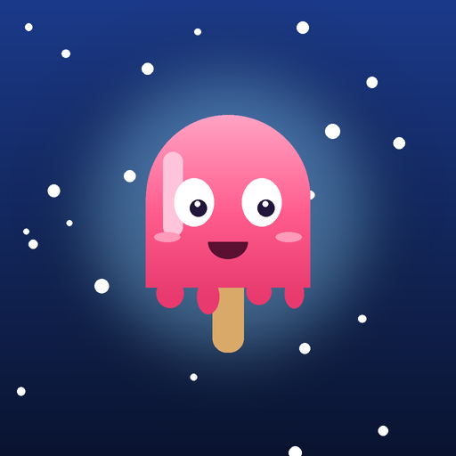
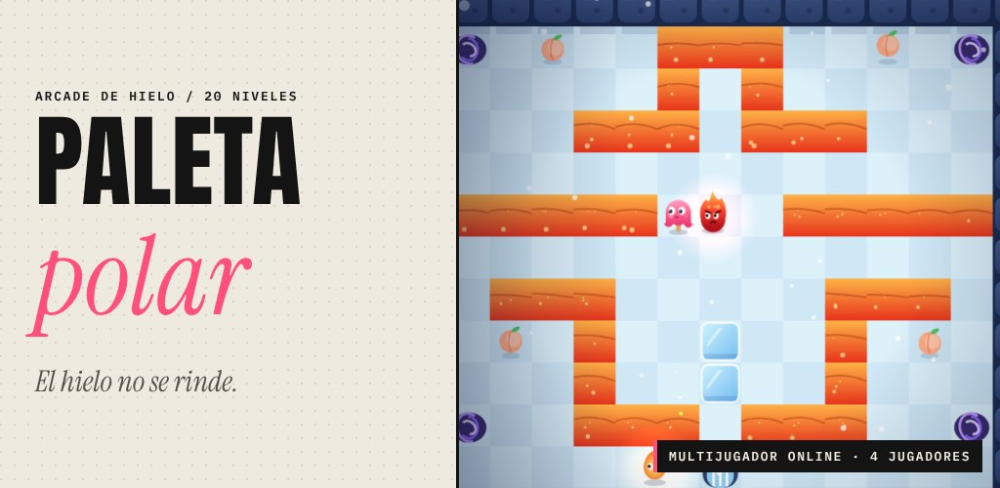
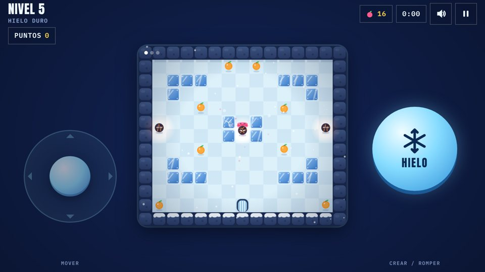
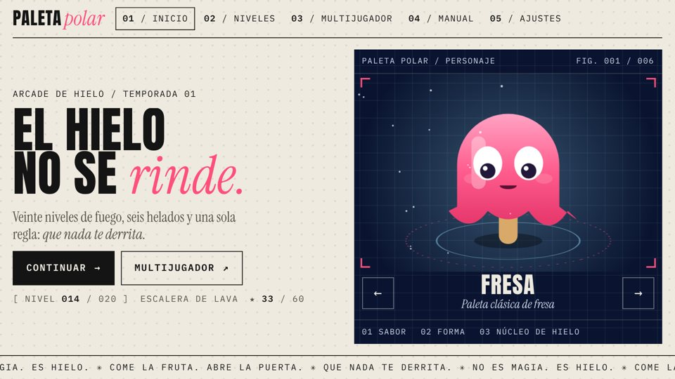
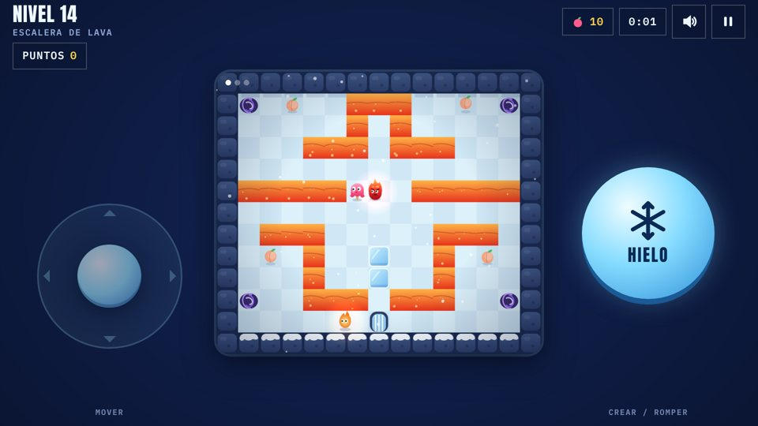
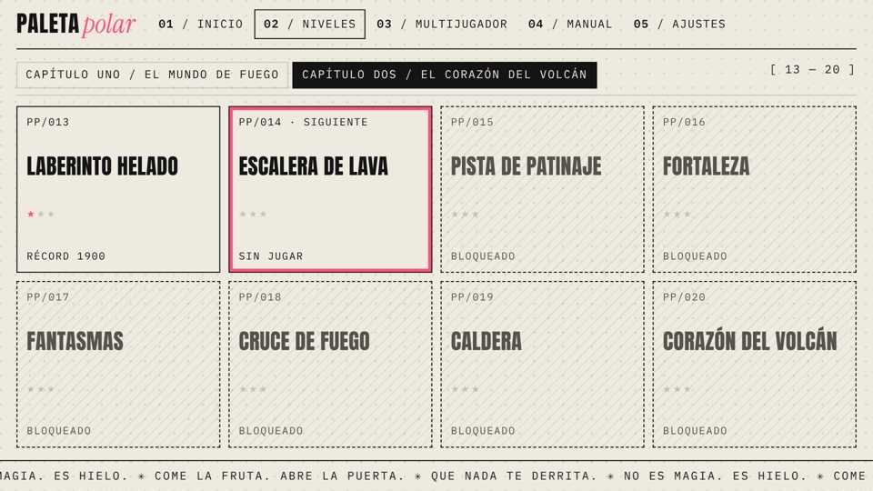
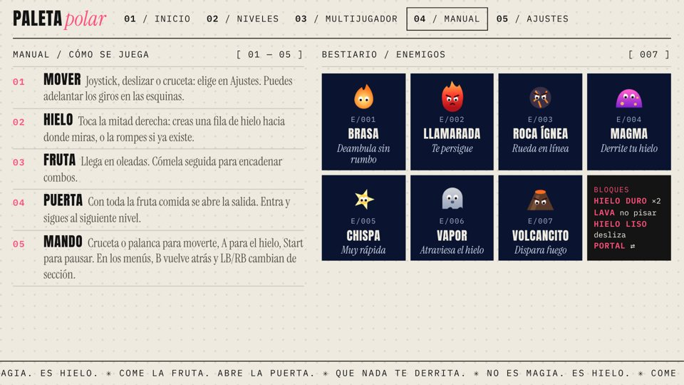
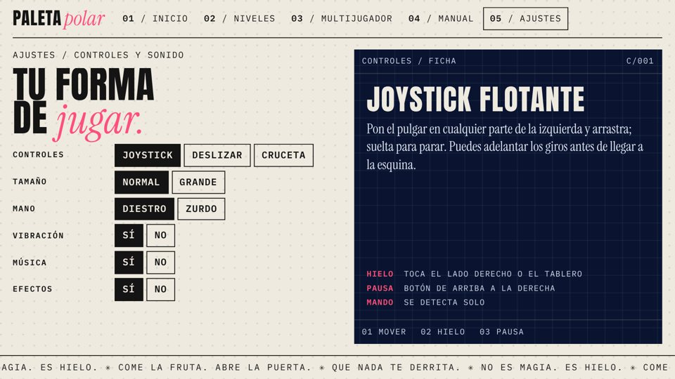

<div align="center">



# Paleta Polar

**Crea y rompe hielo, come fruta y escapa del fuego. Solo o con 3 amigos online.**

[](https://github.com/MrVanguardia/paleta-polar/actions/workflows/build.yml)
[](https://github.com/MrVanguardia/paleta-polar/releases/latest)


[**⬇ Descargar APK**](https://github.com/MrVanguardia/paleta-polar/releases/latest/download/PaletaPolar.apk) ·
[Web](https://mrvanguardia.github.io/paleta-polar/) · [Documentación](docs/DOCUMENTACION.md) ·
[Política de privacidad](https://mrvanguardia.github.io/paleta-polar/privacidad/) ·
[Historial de cambios](CHANGELOG.md)



</div>

---

Paleta Polar es un arcade de laberinto para Android que se juega en horizontal. Eres un helado atrapado en un mundo de fuego: levantas muros de hielo con un toque, los rompes para abrir camino, te comes toda la fruta y corres a la puerta antes de derretirte.

## Capturas

| | |
| :---: | :---: |
|  |  |
|  |  |
|  |  |

## Características

- 🧊 **20 niveles** en 2 capítulos, con estrellas según tu tiempo y combos por comer fruta seguida.
- 🔥 **7 enemigos** con comportamientos distintos: Brasa, Llamarada, Roca ígnea, Magma, Chispa, Vapor y Volcancito.
- 🧱 **Bloques especiales**: hielo duro, lava, suelo resbaladizo y portales.
- 🍦 **6 helados** para elegir: Fresa, Limón, Choco, Arándano, Mango y Coco.
- 🌍 **Multijugador online** de hasta 4 teléfonos con un código de sala, con vidas (1, 3, 5 o infinitas) y dificultad ajustables.
- 🎮 **Mando** en partida y en todos los menús, con teclado en pantalla. Los controles táctiles se ocultan solos.
- 👆 **Tres controles táctiles**: joystick, deslizar o cruceta, con tamaño ajustable y modo zurdo.
- 🎵 **Música y sonido propios**, sintetizados en vivo con Web Audio.
- 📱 Se adapta a cualquier pantalla, de teléfonos pequeños a tabletas, y funciona sin internet en un jugador.
- 🔒 Sin anuncios, sin compras, sin cuentas y sin analítica.

## Instalar

1. Descarga [`PaletaPolar.apk`](https://github.com/MrVanguardia/paleta-polar/releases/latest/download/PaletaPolar.apk) desde Releases.
2. Ábrelo en tu Android (7.0 o superior) y permite instalar apps de esa fuente cuando te lo pida.

## Cómo se juega

| Acción | Táctil | Mando |
| --- | --- | --- |
| Moverse | Joystick, deslizar o cruceta | Cruceta o palanca izquierda |
| Crear o romper hielo | Tocar el lado derecho | A, X o RB |
| Pausa | Botón arriba a la derecha | Start |
| Menús | Tocar | Cruceta, A aceptar, B atrás, LB/RB secciones |

Come toda la fruta de cada oleada, espera a que se abra la puerta y entra por ella para pasar al siguiente nivel sin parar. El [manual completo](docs/DOCUMENTACION.md#manual-del-jugador) explica bloques y enemigos.

## Estructura del proyecto

```
paleta-polar/
├── web-src/            El juego (HTML + CSS + JS en un archivo) y el multijugador
│   ├── game.html       Lógica, niveles, gráficos, sonido y menús
│   ├── peer-room.js    Conexión directa (PeerJS) con respaldo por MQTT
│   └── fonts/          Fuentes incluidas para jugar sin internet
├── native/             App Android ligera (sin Gradle)
│   ├── src/…/MainActivity.java
│   ├── AndroidManifest.xml
│   ├── res/            Iconos y pantalla de carga
│   └── build-apk.sh    Compila el APK y el AAB
├── android/            Alternativa con Capacitor para Android Studio
├── tools/              build-www.py (arma www/) y make-icons.py
├── tests/test.js       Pruebas automáticas (mapas, partidas y red)
├── docs/               Documentación, recursos de Play Store y web (GitHub Pages)
└── .github/            Compilación automática, versiones y plantillas
```

## Compilar

Necesitas Java 17+, Python 3 y Node.js 18+. Con el [Android SDK](https://developer.android.com/tools) (`platforms;android-36` y `build-tools;36.0.0`) y [bundletool](https://github.com/google/bundletool/releases):

```sh
npm test                                   # pruebas
python3 tools/build-www.py                 # arma la carpeta www/
ANDROID_HOME=~/Android/Sdk BUNDLETOOL=~/bundletool-all.jar sh native/build-apk.sh
```

Salen `native/PaletaPolar.apk` (instalación directa) y `native/PaletaPolar.aab` (Google Play). Para firmar el AAB añade `KEYSTORE=/ruta/upload-keystore.jks KS_PASS='…'`. Cada versión para Play necesita un `VERSION_CODE` mayor.

La guía completa, incluida la opción con Android Studio, está en [docs/COMPILAR.md](docs/COMPILAR.md).

### Compilación automática

- Cada cambio en `main` y cada pull request pasa las pruebas y compila un APK, que se descarga desde la pestaña **Actions**.
- Al crear una etiqueta `vX.Y.Z` se publica una versión en **Releases** con el APK y el AAB. Si añades los secretos `UPLOAD_KEYSTORE_BASE64` y `UPLOAD_KEYSTORE_PASSWORD`, el AAB sale firmado y listo para Play ([cómo hacerlo](docs/COMPILAR.md#firmar-en-github)).

## Cómo funciona el multijugador

El teléfono anfitrión ejecuta la partida y envía el estado completo unas 20 veces por segundo; los invitados solo envían su dirección y sus acciones, así que nadie se desincroniza. Primero se intenta una conexión directa entre teléfonos (WebRTC con PeerJS) y, si en 7 segundos no se logra, la partida pasa por brokers MQTT públicos. Más detalles en la [documentación técnica](docs/DOCUMENTACION.md#documentación-técnica).

## Privacidad

El juego no recoge datos personales. El progreso se guarda solo en el teléfono y, en multijugador, el apodo y la partida viajan únicamente a los demás jugadores de la sala. Lee la [política de privacidad](https://mrvanguardia.github.io/paleta-polar/privacidad/).

## Contribuir

Los reportes de errores y las ideas son bienvenidos en [Issues](https://github.com/MrVanguardia/paleta-polar/issues). Lee [CONTRIBUTING.md](CONTRIBUTING.md) antes de abrir un pull request. Para problemas de seguridad, sigue [SECURITY.md](SECURITY.md).

## Licencia

© 2026 MrVanguardia. **Todos los derechos reservados.** El código se publica para que se pueda ver y aprender de él, pero no se permite copiarlo, redistribuirlo ni publicar el juego o versiones modificadas sin permiso. Las librerías y fuentes de terceros mantienen sus propias licencias (MIT y SIL OFL). Ver [LICENSE](LICENSE).

La mecánica de crear y romper hielo se inspira en los clásicos de laberinto; el nombre, los personajes, los niveles, el arte y el sonido de Paleta Polar son originales.
