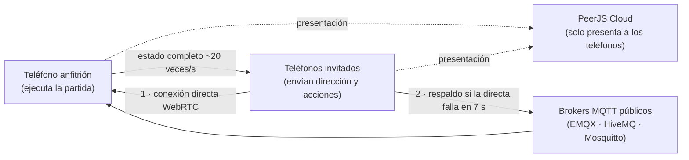

# Paleta Polar — Documentación completa

Versión 1.5.1 · 30 de octubre de 2026

## Resumen

Paleta Polar es un arcade de laberinto para Android en horizontal: un helado crea y rompe muros de hielo para comer fruta, esquivar enemigos de fuego y salir por la puerta de cada nivel. Esta documentación cubre la versión 1.5.1 (código de versión 9).

| Dato | Valor |
| --- | --- |
| Nombre | Paleta Polar |
| Paquete (ID de la app) | com.paletapolar.juego |
| Versión | 1.5.1 (código 9) |
| Plataforma | Android 7.0 (API 24) o superior; también versión web en claude.ai |
| API objetivo | 36 (Android 16), la que exige Google Play desde el 31 de agosto de 2026 |
| Contenido | 20 niveles en 2 capítulos, 6 personajes, 7 enemigos, 12 frutas |
| Modos | Un jugador y multijugador online de hasta 4 teléfonos |
| Controles | Táctil (joystick, deslizar o cruceta) y mando |
| Anuncios / compras | Ninguno |
| Permisos | Internet, estado de la red y vibración |

**Dónde está cada cosa**

- `PaletaPolar.aab` y `PaletaPolar.apk`: en la página [Releases](https://github.com/MrVanguardia/paleta-polar/releases) del repositorio.
- Código fuente: este repositorio.
- Recursos de la ficha de Play Store: [`docs/play-store/`](play-store/).
- Política de privacidad publicada: <https://mrvanguardia.github.io/paleta-polar/privacidad/>.
- La llave de subida (`upload-keystore.jks`) y sus contraseñas **no están en el repositorio**. Guárdalas en un lugar seguro y con copia; sin ellas no podrás publicar actualizaciones.

## Manual del jugador

Come toda la fruta de cada nivel, abre la puerta de salida y entra por ella antes de que el fuego te derrita.

**Cómo se juega**

1. La fruta llega en oleadas; al comer la última de una oleada aparece la siguiente.
2. Al terminar todas las oleadas se abre la puerta. Entrar por ella te lleva al siguiente nivel sin pasar por menús.
3. Las estrellas dependen del tiempo: 3 si terminas dentro del tiempo objetivo del nivel, 2 si tardas hasta 1,6 veces más, 1 si lo terminas.
4. Comer fruta seguida (menos de 1,4 s entre una y otra) multiplica los puntos: 50, 100, 150…

**Controles**

| Acción | Táctil | Mando |
| --- | --- | --- |
| Mover | Joystick, deslizar o cruceta (se elige en Ajustes) | Cruceta o palanca izquierda |
| Crear o romper hielo | Tocar el lado derecho o el tablero | A, X o RB |
| Pausa | Botón de pausa arriba a la derecha | Start |
| Menús | Tocar | Cruceta para moverse, A aceptar, B atrás, LB/RB secciones |

El hielo se crea en fila hacia donde mira el helado, hasta chocar con algo. Si delante ya hay hielo, la misma acción lo rompe. Al usar el mando los controles táctiles se ocultan solos.

**Bloques**

| Bloque | Efecto |
| --- | --- |
| Roca | No se puede romper ni atravesar |
| Hielo | Lo creas y lo rompes; la fruta atrapada dentro hay que liberarla |
| Hielo duro | Necesita 2 golpes para romperse |
| Lava | Nadie del equipo puede pisarla; el fuego sí la cruza |
| Suelo resbaladizo | Te desliza hasta el final de la pista |
| Portal | Te lleva a su pareja |
| Puerta | Cerrada hasta comer toda la fruta |

**Enemigos**

| Enemigo | Comportamiento |
| --- | --- |
| Brasa | Deambula sin rumbo |
| Llamarada | Te persigue |
| Roca ígnea | Rueda en línea recta y gira al chocar |
| Magma | Te persigue y derrite el hielo que encuentra |
| Chispa | Deambula muy rápido |
| Vapor | Te persigue atravesando el hielo |
| Volcancito | No se mueve; dispara bolas de fuego que rompen tu hielo |

**Personajes**: Fresa, Limón, Choco, Arándano, Mango y Coco. Son estéticos; todos juegan igual.

**Multijugador**

- Hasta 4 jugadores, cada uno en su teléfono y desde cualquier lugar con internet.
- El anfitrión toca Multijugador → Crear sala y comparte el código de 4 letras; los demás tocan Unirse.
- El anfitrión elige nivel inicial, vidas por jugador (1, 3, 5 o infinitas, renovadas en cada nivel) y dificultad (Fácil, Normal o Difícil).
- Si se derriten todos, el anfitrión puede reintentar o volver a la sala con todos. La sala se mantiene hasta que el anfitrión sale.

**Ajustes**: tipo de control, tamaño de controles, modo zurdo, vibración, música y efectos.

## Documentación técnica

El juego entero es una página web (HTML, CSS y JavaScript sin librerías de juego) que la app Android muestra en un WebView a pantalla completa. Todo se dibuja en un canvas a 60 fps y el sonido se sintetiza en vivo con Web Audio, sin archivos de audio.

**Estructura del proyecto**

| Ruta | Contenido |
| --- | --- |
| `web-src/game.html` | El juego completo: lógica, niveles, dibujo, audio, menús y multijugador |
| `web-src/peer-room.js` | Capa multijugador de la app: conexión directa (PeerJS) con respaldo por servidor (MQTT) |
| `web-src/peerjs.min.js`, `web-src/mqtt.min.js` | Librerías de red (licencia MIT) |
| `web-src/fonts/` | Fuentes incluidas para jugar sin internet (licencia OFL) |
| `tools/build-www.py` | Arma la carpeta `www/` a partir de `web-src/` |
| `tools/make-icons.py` | Genera icono y pantalla de carga |
| `native/` | App Android ligera: manifiesto, `MainActivity.java`, recursos y `build-apk.sh` |
| `android/` | Proyecto alternativo con Capacitor para Android Studio (apunta a API 34: no sirve para Play sin actualizarlo) |
| `.github/workflows/` | Compilación automática en cada cambio y publicación de versiones al crear una etiqueta `v*` |
| `docs/` | Esta documentación, recursos de Play Store y la web del juego (GitHub Pages) |

**App Android** (`native/`)

- Una sola actividad, `MainActivity`, con un WebView que carga `file:///android_asset/www/index.html`.
- Horizontal en teléfonos (`sensorLandscape`). En tabletas y plegables Android 16 ignora el bloqueo de orientación y el juego se adapta en vertical.
- Borde a borde: el WebView se aparta de la cámara y de las barras visibles con `WindowInsets`. Las barras del sistema se ocultan en modo inmersivo.
- Gesto atrás predictivo (`OnBackInvokedCallback`, Android 13+) y botón atrás clásico: primero se le pregunta al juego (`window.ppBack`), que pausa o vuelve atrás; desde el menú principal la app se cierra.
- Pantalla siempre encendida durante el juego; el audio se suspende en segundo plano.
- `minSdk` 24 (Android 7.0), `targetSdk` 36 (Android 16).

**Compilar** (Linux o macOS, con Java 17+)

1. `python3 tools/build-www.py`
2. `ANDROID_HOME=~/Android/Sdk BUNDLETOOL=~/bundletool-all.jar KEYSTORE=/ruta/upload-keystore.jks KS_PASS='tu-contraseña' VERSION_CODE=10502 VERSION_NAME=1.5.2 sh native/build-apk.sh`
3. Resultado: `native/PaletaPolar.apk` (pruebas) y `native/PaletaPolar.aab` (Google Play, firmado con la llave de subida).

El script usa las herramientas del Android SDK (aapt2, d8, zipalign, apksigner) más bundletool y jarsigner; la carpeta se indica con `ANDROID_HOME` y bundletool con `BUNDLETOOL`. Cada versión que subas a Play necesita un `VERSION_CODE` mayor que el anterior. La guía completa, con la compilación automática en GitHub, está en [COMPILAR.md](COMPILAR.md).

**Pantallas**

- El tablero mide 15 × 13 casillas y se ajusta al alto o al ancho disponible, con tamaño de casilla exacto según la densidad de píxeles.
- Los controles táctiles crecen con el alto de la pantalla y los menús se escalan como una unidad en tabletas, para verse igual que en un teléfono.
- Probado a 640 × 320, 800 × 360, 915 × 412, 1280 × 800 y 800 × 1280.

**Sonido**

Motor propio sobre Web Audio: buses de música y efectos, compresor maestro y reverberación. El hielo usa campanas FM, el fuego ruido filtrado y la música es un secuenciador con tres temas (menú, capítulo uno y capítulo dos) que se mezclan entre pantallas y se apagan en pausa.

**Multijugador**

El anfitrión ejecuta la partida y envía el estado completo unas 20 veces por segundo; los invitados envían solo su dirección y un contador de acciones. Así ninguna partida se desincroniza. El diagrama de abajo muestra los dos caminos de conexión.

La conexión directa es la más rápida; el broker solo retransmite cuando la directa no se logra, y nada se guarda en él.

**Cambiar el juego**

- Niveles: lista `LEVELS` en `game.html`, mapas de 15 × 13 caracteres con la leyenda escrita encima.
- Textos de menús: funciones `showMenu`, `showLevels`, `showSettings` y similares.
- Después de editar: vuelve a ejecutar los pasos de Compilar.

## Guía de publicación en Google Play

El paquete `PaletaPolar.aab` ya cumple los requisitos técnicos de Google Play a octubre de 2026: formato App Bundle, firma con llave de subida, API objetivo 36 ([requisito vigente desde el 31 de agosto de 2026](https://developer.android.com/google/play/requirements/target-sdk)), sin código nativo, sin anuncios y con permisos mínimos. Lo que falta son los pasos de tu cuenta.

**Antes de empezar**

- [ ] Cuenta de desarrollador de Google Play (pago único de 25 USD) con identidad verificada.
- [ ] Copia de seguridad de `upload-keystore.jks` y `CLAVES-FIRMA.txt` fuera del teléfono y de la computadora (por ejemplo, un USB y una nube privada).
- [x] Política de privacidad publicada en una dirección web (paso 1).
- [x] Política con desarrollador (OFICIO CERO) y correo de contacto (hola@oficiocero.com).

**Pasos**

1. **Publica la política de privacidad.** Ya está publicada con GitHub Pages desde la carpeta `docs/` de este repositorio: <https://mrvanguardia.github.io/paleta-polar/privacidad/>. Esa es la dirección que se pega en Play Console.
2. **Crea la app** en Play Console → Crear app: nombre Paleta Polar, idioma predeterminado español, tipo Juego, gratuita. Acepta las declaraciones.
3. **Configura la firma.** Al subir el primer AAB, acepta Firma de apps de Google Play (Play guarda la llave final de la app; tu `upload-keystore.jks` solo sirve para subir versiones).
4. **Completa Contenido de la app** (menú Política → Contenido de la app):
   - Política de privacidad: la dirección del paso 1.
   - Anuncios: No contiene anuncios.
   - Acceso a la app: todas las funciones están disponibles sin restricciones.
   - Público objetivo: 13 años o más (ver la sección Clasificación).
   - Seguridad de los datos: respuestas de la sección de este documento.
   - Clasificación de contenido: cuestionario de la sección de este documento.
   - Aplicación gubernamental, financiera, de salud, noticias: No.
5. **Ficha de Play Store**: textos e imágenes de la sección siguiente.
6. **Prueba cerrada**: las cuentas personales creadas después de noviembre de 2023 deben tener al menos 12 testers inscritos durante 14 días seguidos antes de pedir acceso a producción. Ve a Pruebas → Prueba cerrada, sube `PaletaPolar.aab`, agrega los correos de tus amigos y comparte con ellos el enlace de inscripción.
7. **Producción**: tras los 14 días, pide acceso a producción, crea una versión en Producción con el mismo AAB (o uno nuevo con código de versión mayor) y envíala a revisión. La revisión suele tardar de unas horas a varios días.

**Actualizaciones**

Sube un AAB con `VERSION_CODE` mayor, firmado con la misma llave de subida. Si pierdes la llave de subida, Play permite restablecerla desde Configuración → Integridad de la app, con un proceso de verificación.

**Detalles a tener en cuenta**

- El APK de pruebas está firmado con una llave de depuración distinta. Antes de instalar la versión de Play en un teléfono que tenga el APK de pruebas, hay que desinstalar el de pruebas (se pierde el progreso guardado).
- No menciones otros juegos ni marcas en la ficha ni en las capturas.

## Ficha de Play Store

Textos listos para copiar, dentro de los límites de Google Play (título 30 caracteres, descripción breve 80, completa 4000).

| Campo | Valor |
| --- | --- |
| Nombre (30) | Paleta Polar |
| Categoría | Juegos → Arcade |
| Etiquetas sugeridas | Arcade, Laberinto, Multijugador, Casual |
| Correo de contacto | El de tu cuenta de desarrollador |
| Política de privacidad | La dirección de GitHub Pages del paso 1 |

**Descripción breve (español, 71 caracteres)**

Crea y rompe hielo, come fruta y escapa del fuego. Solo o con 3 amigos.

**Descripción completa (español)**

Eres un helado en un mundo de fuego. Levanta muros de hielo con un toque, rómpelos para abrir camino, come toda la fruta y corre a la puerta antes de que te derritan.

- 20 niveles en 2 capítulos: del mundo de fuego al corazón del volcán.
- 7 enemigos distintos: brasas que deambulan, llamaradas que te persiguen, magma que derrite tu hielo, vapor que lo atraviesa y volcancitos que disparan.
- Hielo duro, lava, suelo resbaladizo y portales que cambian cada nivel.
- 6 helados para elegir: Fresa, Limón, Choco, Arándano, Mango y Coco.
- Multijugador online para hasta 4 amigos, cada uno en su teléfono. Elige vidas y dificultad.
- Tres tipos de control táctil (joystick, deslizar o cruceta), modo zurdo y soporte de mando.
- Música y efectos propios. Sin anuncios, sin compras, sin cuentas.

¿Cuántas estrellas puedes sacar en los 20 niveles?

**Short description (English, 72 characters)**

Build and break ice, eat fruit, escape the fire. Solo or with 3 friends.

**Full description (English)**

You are an ice pop in a world of fire. Raise ice walls with a tap, break them to open a path, eat every fruit and reach the door before you melt.

- 20 levels across 2 chapters.
- 7 enemies: wandering embers, chasing flames, ice-melting magma, steam that passes through ice and fire-spitting volcanoes.
- Hard ice, lava, slippery floors and portals.
- 6 ice pops to choose from.
- Online multiplayer for up to 4 friends, each on their own phone, with adjustable lives and difficulty.
- Joystick, swipe or D-pad touch controls, left-handed mode and gamepad support.
- Original music and sound. No ads, no purchases, no accounts.

**Recursos gráficos** (en [`docs/play-store/`](play-store/))

| Archivo | Uso en Play Console | Tamaño |
| --- | --- | --- |
| `icono-512.png` | Icono de la app | 512 × 512 px, PNG |
| `grafico-destacado-1024x500.png` | Gráfico de funciones | 1024 × 500 px, PNG sin transparencia |
| `capturas/01` a `06` | Capturas de teléfono (sube 4 a 6) | 1920 × 1080 px |
| `capturas/tablet-01` y `tablet-02` | Capturas de tablet de 7 y 10 pulgadas | 2560 × 1600 px |

Sugerencia de orden de capturas: partida, capítulo dos, inicio, niveles, bestiario, ajustes.

## Seguridad de los datos

Respuestas recomendadas para el formulario de Play Console. Google considera "recopilados" los datos que salen del teléfono aunque el desarrollador no los guarde, por eso se declaran el apodo y la actividad en la partida del multijugador.

**Preguntas generales**

| Pregunta | Respuesta |
| --- | --- |
| ¿La app recopila o comparte alguno de los tipos de datos requeridos? | Sí |
| ¿Todos los datos se encriptan en tránsito? | Sí (TLS y DTLS) |
| ¿Ofreces una forma de pedir que se borren los datos? | No hace falta: no se guardan datos en servidores; lo local se borra al limpiar los datos de la app |

**Tipos de datos a declarar**

| Categoría → tipo | Recopilado | Compartido | Obligatorio | Finalidad |
| --- | --- | --- | --- | --- |
| Información personal → Otra información (apodo de juego) | Sí | Sí, con los demás jugadores de la sala | Opcional (solo multijugador) | Funcionalidad de la app |
| Actividad en la app → Otras acciones (movimientos y estado de la partida) | Sí | Sí, con los demás jugadores de la sala | Opcional (solo multijugador) | Funcionalidad de la app |

Marca ambos como procesados de forma efímera: viajan durante la partida y no se almacenan.

**Lo que no se declara**: ubicación, contactos, fotos, audio, archivos, correo, identificadores del dispositivo, datos de compras, salud, finanzas, historial de navegación, registros de fallos y diagnósticos. La app no usa ninguno.

**Sobre los servicios de conexión**: la dirección IP llega a los servicios de conexión (PeerJS y los brokers MQTT) como parte normal de cualquier conexión a internet. Google no exige declararla como dato recopilado cuando solo se usa para establecer la conexión, pero la política de privacidad la menciona igualmente.

## Clasificación de contenido y público objetivo

La clasificación esperada es la más baja en casi todos los sistemas (PEGI 3, ESRB Everyone), porque la única "violencia" es un helado que se derrite, sin sangre ni daño realista.

**Cuestionario IARC (respuestas recomendadas)**

| Pregunta | Respuesta |
| --- | --- |
| Categoría | Juego |
| Violencia | Sí, fantasía o caricatura, sin sangre (personajes de fuego que "derriten" al jugador) |
| Miedo, sexualidad, lenguaje soez, drogas, alcohol, tabaco | No |
| Apuestas o simulación de apuestas | No |
| ¿Los usuarios pueden interactuar o intercambiar contenido? | Sí: en multijugador ven el apodo de los demás (sin chat) |
| ¿Se comparte la ubicación del usuario? | No |
| ¿Compras digitales? | No |

**Público objetivo: 13 años o más (recomendado)**

- Si incluyes menores de 13, la app entra en el programa Diseñado para familias y debe cumplir requisitos extra: servicios de terceros certificados para niños y controles sobre el contenido que generan los usuarios. Los apodos libres del multijugador y los brokers públicos no cumplen esos requisitos hoy.
- Con 13+ el estilo sigue siendo apto para todos y no hace falta cambiar el juego.
- En "¿La ficha podría atraer a niños?" responde con sinceridad; si Google considera que sí, puede pedir la revisión de Familias. En ese caso, la vía es una versión sin multijugador para el público infantil.

## Política de privacidad

Vigente desde el 30 de octubre de 2026. La versión para publicar en la web, en español e inglés, está en [`docs/privacidad/index.html`](privacidad/index.html) y se publica sola en <https://mrvanguardia.github.io/paleta-polar/privacidad/>.

**Resumen.** Paleta Polar no pide cuentas, no muestra anuncios, no usa analítica y no guarda tus datos en servidores propios. Tu progreso se queda en tu teléfono. En el multijugador, tu apodo, tu personaje y el estado de la partida viajan a los otros jugadores de la sala a través de los servicios de conexión descritos abajo.

**Responsable.** Desarrollador: OFICIO CERO. Contacto: hola@oficiocero.com.

**Datos guardados en tu teléfono.** Progreso (estrellas y récords), personaje, apodo y ajustes. Se guardan solo en el almacenamiento de la app y se borran al desinstalarla o al borrar sus datos en Ajustes de Android.

**Datos enviados al jugar en línea**

| Dato | A quién llega | Para qué |
| --- | --- | --- |
| Apodo y personaje | Los demás jugadores de la sala | Mostrarte en la sala y en la partida |
| Movimientos y estado de la partida | Los demás jugadores de la sala | Sincronizar el juego |
| Dirección IP e identificadores aleatorios | Servicios de conexión y, en conexión directa, los otros jugadores | Establecer la conexión |

No se envía tu nombre real, correo, ubicación, contactos ni identificadores del dispositivo. No uses tu nombre real como apodo.

**Servicios de terceros.** PeerJS Cloud (0.peerjs.com) pone en contacto a los teléfonos; los servidores STUN de Google y Twilio ayudan a cada teléfono a conocer su dirección pública; los brokers MQTT públicos EMQX, HiveMQ y Eclipse Mosquitto retransmiten la partida cuando la conexión directa no es posible. Las conexiones van cifradas en tránsito. Los mensajes pasan por estos servicios durante la partida y el desarrollador no los almacena.

**Permisos.** Internet y estado de la red (multijugador) y vibración (se puede apagar en Ajustes). Sin acceso a cámara, micrófono, ubicación, contactos ni archivos.

**Menores.** La app no está dirigida a menores de 13 años y no recopila a sabiendas datos personales de menores.

**Conservación.** El desarrollador no conserva datos tuyos.

**Cambios.** Las nuevas versiones de esta política se publicarán en la misma página con su fecha de vigencia.

## Términos de uso

Vigentes desde el 30 de octubre de 2026. Google Play no exige términos de uso, pero conviene tenerlos publicados junto a la política de privacidad.

1. **Aceptación.** Al instalar o usar Paleta Polar aceptas estos términos. Si no estás de acuerdo, no uses la app.
2. **Licencia.** Te damos una licencia personal, gratuita, no exclusiva e intransferible para usar la app en tus dispositivos. No puedes venderla, redistribuirla ni publicar versiones modificadas como propias.
3. **Multijugador.** Elige un apodo respetuoso y que no sea tu nombre real. No uses apodos ofensivos, que suplanten a otra persona o que incluyan datos personales. El multijugador depende de servicios de terceros gratuitos y puede no estar disponible en algún momento.
4. **Conducta.** No intentes interferir con las partidas de otros, modificar el tráfico de red ni usar la app para fines ilegales.
5. **Propiedad intelectual.** El juego, sus personajes, niveles, gráficos y sonidos pertenecen a OFICIO CERO. Las librerías y fuentes de terceros se usan según sus licencias (ver Licencias de terceros).
6. **Sin garantías.** La app se ofrece "tal cual". No garantizamos que funcione sin interrupciones ni errores.
7. **Responsabilidad.** En la medida que permita la ley, el desarrollador no responde por daños indirectos derivados del uso de la app.
8. **Cambios.** Podemos actualizar la app y estos términos. Publicaremos los cambios con su fecha.
9. **Contacto.** hola@oficiocero.com.

## Licencias de terceros

Todo el código del juego, los gráficos (dibujados por código) y el sonido (sintetizado en vivo) son originales. Estos componentes de terceros se incluyen en la app; todas sus licencias permiten el uso comercial.

| Componente | Versión | Uso | Licencia |
| --- | --- | --- | --- |
| PeerJS | 1.5.4 | Conexión directa entre teléfonos | MIT |
| MQTT.js | 5.10.1 | Conexión por servidor | MIT |
| Anton | Fontsource 5.3.0 | Títulos de los menús | SIL Open Font License 1.1 |
| IBM Plex Mono | Fontsource 5.3.0 | Etiquetas y botones | SIL Open Font License 1.1 |
| Instrument Serif | Fontsource 5.3.0 | Textos en cursiva | SIL Open Font License 1.1 |
| Lilita One | Fontsource 5.1.0 | Textos dentro del juego | SIL Open Font License 1.1 |
| Nunito | Fontsource 5.1.0 | Textos de apoyo | SIL Open Font License 1.1 |

La licencia MIT pide conservar el aviso de copyright: está en [`THIRD_PARTY_NOTICES.md`](../THIRD_PARTY_NOTICES.md), que se copia dentro de la app junto con `fonts/OFL.txt`. La licencia OFL permite incluir las fuentes en la app siempre que no se vendan por separado.

La mecánica de crear y romper hielo está inspirada en los juegos de laberinto clásicos; las mecánicas no tienen derechos de autor, y el nombre, los personajes y el arte de Paleta Polar son propios.

## Historial de versiones

| Versión | Fecha | Cambios |
| --- | --- | --- |
| 1.5.1 (9) | 2026-10-30 | Pulido: un toque = una acción en todos los botones (sin dobles), salas que no se duplican al tocar dos veces, hielo que no se crea y rompe por un toque doble, pausa y botón atrás sin rebotes, joystick que nunca se queda pegado, botones sin resaltado pegado en pantallas táctiles, aviso cuando el anfitrión no responde y dibujo del tablero más ligero para teléfonos modestos |
| 1.5.0 (8) | 2026-10-30 | API 36 para Google Play, paquete AAB firmado, borde a borde y gesto atrás predictivo; adaptación a teléfonos de todos los tamaños y tabletas; nuevo motor de sonido con música por capítulo, reverberación y ajustes de música y efectos |
| 1.4.0 (7) | 2026-10-30 | Controles táctiles: deslizar, cruceta fija y joystick más ágil; giros rápidos que no se pierden; pantalla de Ajustes con tamaño, modo zurdo y vibración |
| 1.3.0 (6) | 2026-10-30 | Multijugador online con respaldo por servidor; controles táctiles ocultos al usar mando |
| 1.2.0 (5) | 2026-10-30 | Mando en los menús y teclado en pantalla; la sala se mantiene tras perder; vidas y dificultad configurables; capítulo dos con 8 niveles nuevos |
| 1.1.0 | 2026-10-30 | Menús rediseñados con estilo editorial |
| 1.0.0 | 2026-10-30 | Primera versión: 12 niveles, 6 personajes, 7 enemigos, multijugador, puerta de salida y mando |

